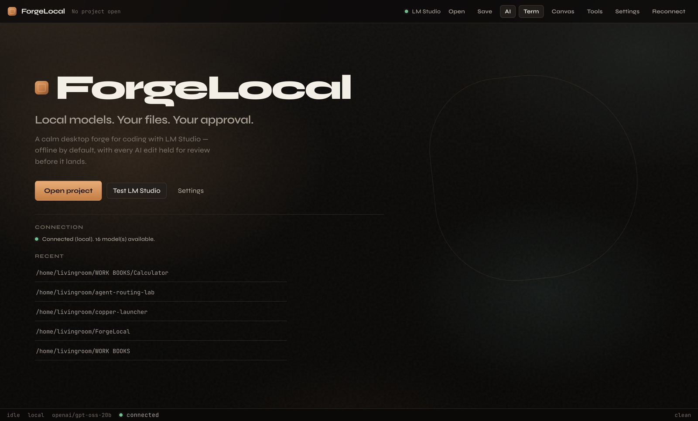
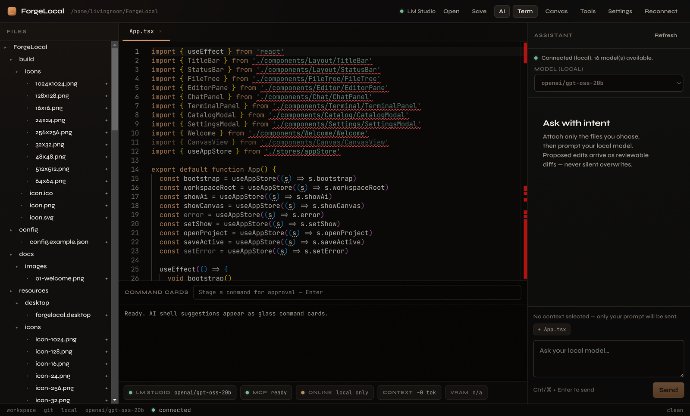
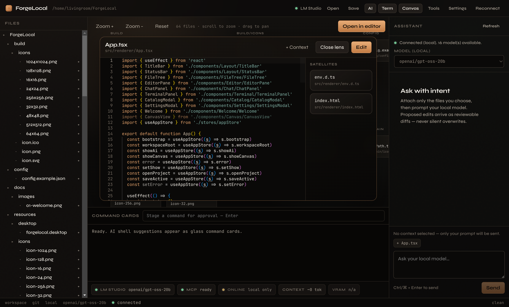
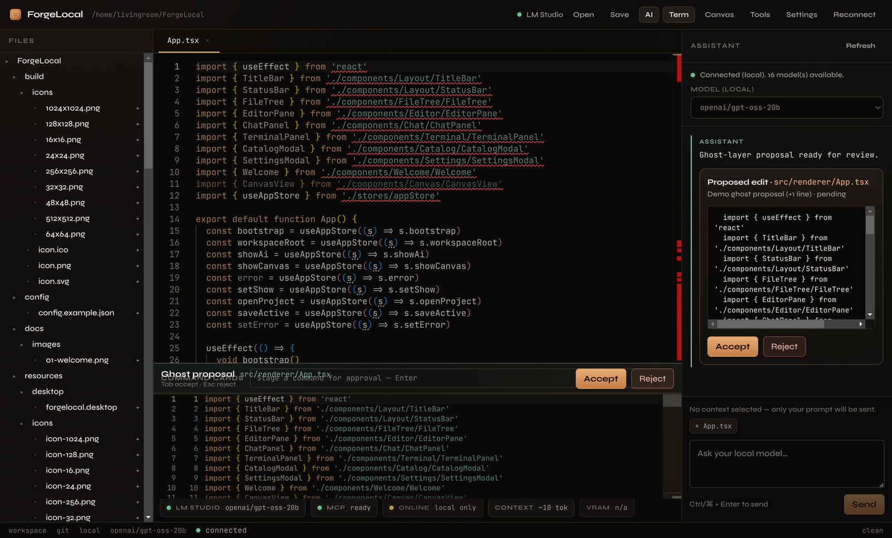
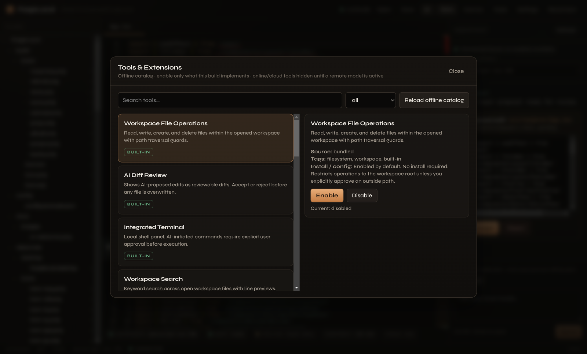
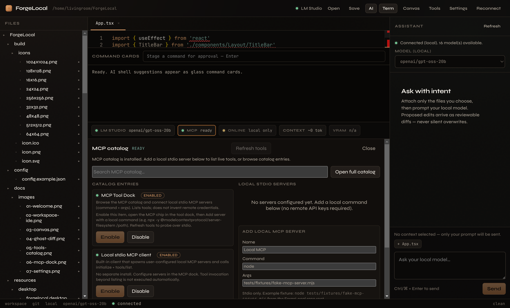
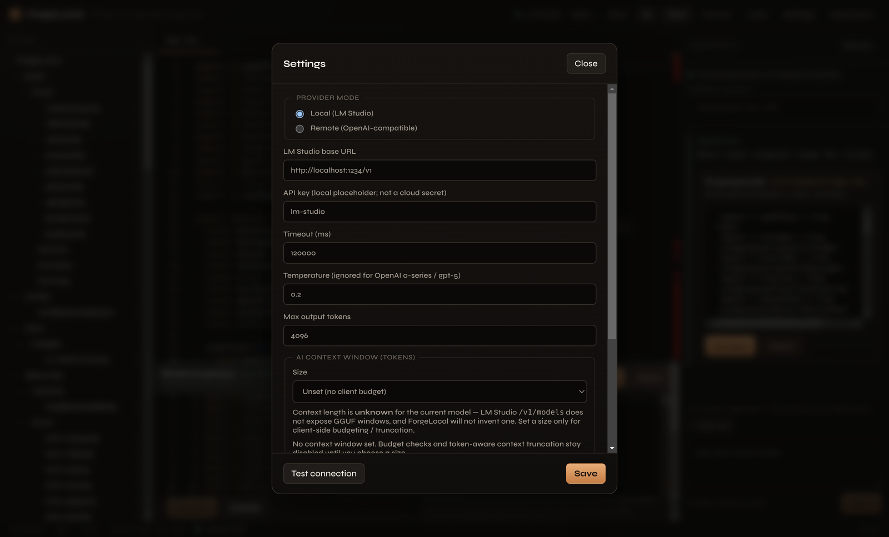

# ForgeLocal

**Local models. Your files. Your approval.**

ForgeLocal is a calm, local-first desktop IDE for coding with [LM Studio](https://lmstudio.ai/). It keeps your project on disk, talks to a local OpenAI-compatible server by default, and never silently overwrites files — every AI edit lands as a reviewable diff.

Inspired by LocalForge, Cline, and Cursor, built around a **forge-ember** look (deep ink, warm copper, quiet celadon) rather than purple dashboard chrome.

<p align="center">
  
</p>

<p align="center"><em>Welcome — open a project, test LM Studio, or jump into Settings.</em></p>

---

## Contents

- [What you get](#what-you-get)
- [Screenshots](#screenshots)
- [Prerequisites](#prerequisites)
- [Install & run](#install--run)
- [Linux desktop shortcut](#linux-desktop-shortcut)
- [LM Studio setup (local)](#lm-studio-setup-local)
- [Remote OpenAI-compatible models](#remote-openai-compatible-models)
- [AI context window](#ai-context-window)
- [MCP dock](#mcp-dock)
- [End-to-end workflow](#end-to-end-workflow)
- [Token & chat payload parameters](#token--chat-payload-parameters)
- [Offline behavior](#offline-behavior)
- [Test / quality](#test--quality)
- [Build / package](#build--package)
- [Troubleshooting](#troubleshooting)
- [Stack](#stack)
- [Project layout](#project-layout)
- [License](#license)

---

## What you get

| Area          | What it does                                                                                  |
| ------------- | --------------------------------------------------------------------------------------------- |
| **IDE**       | Monaco editor with tabs, file tree, search, and Command Cards for approved shell commands     |
| **Assistant** | Chat against LM Studio (or a remote OpenAI-compatible API you configure)                      |
| **Context**   | You mark files with `+` — only those files are attached                                       |
| **Diffs**     | Proposed edits appear as Accept / Reject reviews (ghost layer + assistant cards)              |
| **Canvas**    | Optional infinite map of the workspace with a focus lens                                      |
| **MCP dock**  | Configure local **stdio** MCP servers, probe tools, browse the offline catalog                |
| **Safety**    | Workspace path confinement by default; no silent cloud fallback from local mode; no telemetry |

The IDE stays in the **main window** (there is no pop-out IDE).

---

## Screenshots

### Workspace / IDE

<p align="center">
  
</p>

<p align="center"><em>File tree, Monaco editor, Command Cards, LM Studio assistant — all in one window.</em></p>

### Infinite canvas

<p align="center">
  
</p>

<p align="center"><em>Canvas map with focus lens, satellites, and “Open in editor”.</em></p>

### Ghost-layer diffs

<p align="center">
  
</p>

<p align="center"><em>AI proposals overlay the editor — Accept (writes after confirm) or Reject. Tab / Esc also work when focused.</em></p>

### Tools & extensions catalog

<p align="center">
  
</p>

<p align="center"><em>Bundled offline catalog. Online/cloud tools stay hidden until a remote model is active.</em></p>

### MCP dock

<p align="center">
  
</p>

<p align="center"><em>Local stdio MCP: add a server, probe tools, keep credentials off the network by default.</em></p>

### Settings (provider + context window)

<p align="center">
  
</p>

<p align="center"><em>Local / remote mode, temperature, max output tokens, and optional AI context window presets.</em></p>

---

## Prerequisites

- **Node.js 20+** (tested with 22) and **npm 10+**
- **[LM Studio](https://lmstudio.ai/)** installed separately for local AI chat
- **Linux / macOS / Windows** (Linux desktop shortcut script included)

---

## Install & run

```bash
git clone https://github.com/tbwcheatwood-hue/forgelocal.git
cd forgelocal
npm install
npm run dev
```

Optional reference for provider defaults (runtime settings live in `electron-store`, not this file):

```bash
cp config/config.example.json ./config.local.example.json
```

Dev wrapper used by the Linux desktop entry:

```bash
./scripts/forgelocal-dev.sh
```

On Linux, `npm run dev` sets `ELECTRON_DISABLE_SANDBOX=1` so Electron can start without a root-owned SUID `chrome-sandbox` (no sudo required). That is the supported local-dev path.

If you prefer the real Chromium sandbox instead:

```bash
sudo chown root:root node_modules/electron/dist/chrome-sandbox
sudo chmod 4755 node_modules/electron/dist/chrome-sandbox
```

Then remove `ELECTRON_DISABLE_SANDBOX=1` from the `dev` / `preview` scripts in `package.json`. Re-running `npm install` may restore a non-root sandbox binary.

### App icon

Forge-ember hammer-and-anvil mark:

- Source: `resources/icons/icon.svg`
- Window / packaging: `resources/icons/icon.png`, `build/icon.png`, `build/icons/*`, `build/icon.ico`

---

## Linux desktop shortcut

```bash
./scripts/install-desktop-shortcut.sh --desktop
```

This writes `~/.local/share/applications/forgelocal.desktop`, installs hicolor icons, and optionally `~/Desktop/ForgeLocal.desktop` (GNOME “trusted” metadata when `gio` is available).

If the icon does not refresh immediately: log out/in, or restart the session on Wayland. On X11 GNOME you can try `Alt+F2` then `r`.

Missing GTK / NSS libs on Debian/Ubuntu-style systems:

```bash
sudo apt install libgtk-3-0 libnss3 libgbm1 libasound2
```

---

## LM Studio setup (local)

1. Install [LM Studio](https://lmstudio.ai/).
2. Download and load a **chat** model (embedding models are filtered out of ForgeLocal’s picker).
3. Start the local server (**Developer → Start Server**).
4. Default API base URL: `http://localhost:1234/v1`.
5. In ForgeLocal: **Settings** → Provider mode **Local**, or click **Reconnect**, then select a discovered model.
6. Open files, mark context with `+` in the file tree, send a prompt, review diffs.

Local mode never silently falls back to a cloud provider.

---

## Remote OpenAI-compatible models

1. **Settings → Provider mode → Remote**
2. Set base URL (for example `https://api.openai.com/v1`) and an API key (stored locally in electron-store; never logged).
3. **Test connection**, then pick a model from the list.
4. Online tools/extensions unlock in the catalog / dock only while a remote model is active. Switching back to Local disables them.

---

## AI context window

ForgeLocal does **not** invent per-GGUF context sizes. LM Studio’s OpenAI-compatible `/v1/models` typically returns only `id` / `object` / `owned_by`.

In **Settings → AI context window (tokens)** you can:

- Leave it **Unset** (no client-side token budget)
- Pick a **preset** (4k–128k) or enter a **custom** size

When set, that value:

1. Rejects chat requests where estimated input (chars÷4) + max output cannot fit
2. Truncates attached context files to leave room for the prompt and max output

If a server _does_ return metadata (`max_model_len`, `context_length`, …), values above that known limit are blocked. Switching to a model with a smaller known limit clears an oversized saved window.

---

## MCP dock

The tool dock’s **MCP** chip opens a panel for:

- Browsing MCP-related catalog entries
- Adding **local stdio** servers (`command` + `args`)
- Probing `initialize` + `tools/list`

Tool **invocation** from chat is not auto-run — the dock is for discovery and honest status.

### Add a local MCP server

1. Open a project → click **MCP** in the dock.
2. **Add server**, for example:
   - Fixture: `command=node`, `args=tests/fixtures/fake-mcp-server.mjs` (from the repo root)
   - Filesystem example: `command=npx`, `args=-y @modelcontextprotocol/server-filesystem /abs/path`
3. **Refresh tools** / **Probe** to list tools over stdio.

ForgeLocal does not invent remote MCP credentials.

---

## End-to-end workflow

1. **Open a project** (Welcome → Open project, or File → Open Project).
2. Connect LM Studio and pick a model.
3. Open files; mark context with `+` in the file tree (nothing else is sent).
4. Prompt in the Assistant panel (`Ctrl/⌘ + Enter`).
5. Review proposed diffs → **Accept** (writes after confirm) or **Reject**.
6. AI shell suggestions appear as **Command Cards** and need explicit approval before running.

Optional polish (catalog tools, enabled by default for a gift experience):

- **Canvas** — workspace map + focus lens
- **Ghost layer** — holographic diff under the active file
- **Intent radial** — right-click / hold / Ctrl+Shift+Space → Extract · Optimize · Tests · Explain
- **Syntax dimming** — dims lines outside the current selection when enabled

---

## Token & chat payload parameters

ForgeLocal uses OpenAI-compatible `POST /v1/chat/completions` for both local and remote providers.

| Mode / model family                                         | Output limit param      | Temperature                    |
| ----------------------------------------------------------- | ----------------------- | ------------------------------ |
| Local LM Studio (documented)                                | `max_tokens`            | Sent (default `0.2`)           |
| Remote `api.openai.com`                                     | `max_completion_tokens` | Sent unless reasoning model    |
| Remote o-series / gpt-5 IDs (`o1*`, `o3*`, `o4*`, `gpt-5*`) | `max_completion_tokens` | **Omitted**                    |
| Other remote OpenAI-compat hosts                            | `max_tokens`            | Sent unless reasoning ID match |

Defaults: `maxOutputTokens: 4096`, `temperature: 0.2`.

Large prompts: soft-warn around ~24k characters; hard-block over 100k. Context and chat history are truncated for IPC / store safety.

Evidence:

- [LM Studio Chat Completions](https://lmstudio.ai/docs/developer/openai-compat/chat-completions) lists `max_tokens`
- [OpenAI Chat Completions](https://platform.openai.com/docs/api-reference/chat/create) prefer `max_completion_tokens`; `max_tokens` is incompatible with o-series

---

## Offline behavior

- Project files, chat history, settings, and the tools catalog live on disk locally
- `resources/catalog.json` works with no network; “Reload offline catalog” re-reads the bundled file
- Core IDE features (open project, edit, search, terminal approval, diff review) do not require internet
- Default AI chat needs a reachable **local** LM Studio server
- Optional remote mode is explicit in Settings — no silent cloud fallback
- UI fonts load from Google Fonts when online; offline, the UI falls back to system fonts
- Monaco is **bundled locally** (no CDN) so the editor works offline

---

## Test / quality

```bash
npm run format:check
npm run lint
npm run typecheck
npm test
```

---

## Build / package

```bash
npm run build
npm run package
```

- `build` — electron-vite compile of main / preload / renderer
- `package` — unpackaged app under `release/` via electron-builder

---

## Troubleshooting

| Symptom                                        | Likely cause / fix                                                                                                                     |
| ---------------------------------------------- | -------------------------------------------------------------------------------------------------------------------------------------- |
| `chrome-sandbox` / `setuid_sandbox_host` FATAL | Use `npm run dev` (sandbox disabled in script), or apply `chown`/`chmod` on `chrome-sandbox`                                           |
| Missing GTK / NSS libs                         | `sudo apt install libgtk-3-0 libnss3 libgbm1 libasound2`                                                                               |
| `stopped` / connection refused                 | LM Studio not running or Local Server not started                                                                                      |
| `unreachable` / timeout                        | Wrong port/base URL, firewall, or hung server                                                                                          |
| `no-model`                                     | Server up but no chat model loaded                                                                                                     |
| Blank / stuck editor                           | Update to a build that bundles Monaco locally; avoid CDN. Canvas is optional via the TitleBar — it no longer steals the editor on boot |
| Remote missing API key                         | Remote mode requires a key in Settings                                                                                                 |
| Online tools hidden                            | Local mode active or no remote model selected                                                                                          |
| Remote o-series / gpt-5 HTTP 400               | ForgeLocal omits `temperature` and sends `max_completion_tokens` for those IDs                                                         |
| Token budget errors                            | Set or lower **AI context window** / max output in Settings                                                                            |
| Huge paste “crash”                             | Soft-warn ~24k chars; hard-block over 100k                                                                                             |

---

## Stack

- **Electron** + **React 18** + **TypeScript** + **Vite (electron-vite)**
- **Monaco** (local bundle + Vite workers)
- **Zustand** + **electron-store** + **electron-builder** + **Vitest**
- Provider: OpenAI-compatible API; default `http://localhost:1234/v1`
- Fonts: Syne (UI) + JetBrains Mono (code, ligatures)
- Terminal: approved `shell: true` child processes (Command Cards), not a full interactive PTY
- **No telemetry / analytics / automatic cloud uploads**

---

## Project layout

```
src/main/          Electron main: FS, LM Studio, catalog, MCP, IPC, security
src/preload/       contextBridge API
src/renderer/      React UI (IDE, chat, diffs, catalog, canvas)
src/shared/        Shared types, chat payload, context window helpers
resources/         Offline tools catalog + icons
config/            Example settings (no secrets)
docs/images/       README screenshots
scripts/           Dev launcher + desktop shortcut installer
tests/             Vitest unit tests
```

---

## License

MIT
